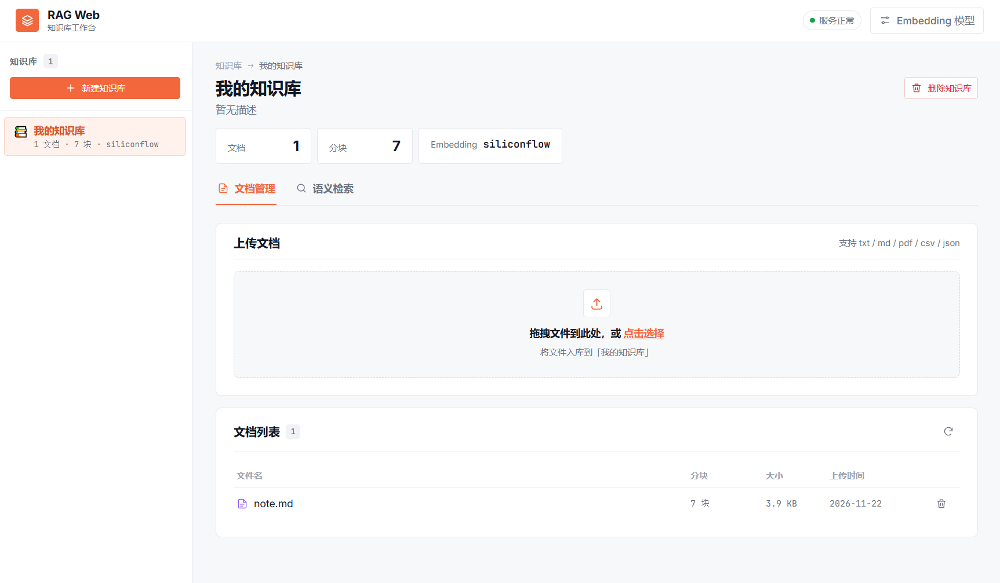

# RAG Web 知识库

一个独立的 RAG Web 应用：FastAPI 后端 + 单页前端，核心是 SQLite 元数据、FAISS 稠密向量、
FTS5/BM25 稀疏检索与加权融合。
**零 API key 即可跑通**：默认 `local-hash` embedding 是纯本地确定性向量；
也可以换成云端语义模型（见下文）。



*界面采用「侧边栏知识库 + 文档管理 / 语义检索 / 知识库对话」多视图布局，Flat 设计风格；截图展示文档管理视图。*

## 目录结构

```
rag_core/
  models.py                  三张元数据表（KnowledgeBase / KBDocument / KBMedia）
  kb_db.py                   元数据 SQLite CRUD
  vec_db/faiss_impl/         FAISS 索引、chunk 文本表、FTS5 索引
  chunking/                  递归字符分块 + Markdown 标题分块
  retrieval/                 稀疏检索、分数融合、检索总控
  embeddings.py              EmbeddingProvider 契约 + local-hash / OpenAI 兼容两种实现
  llm.py                     OpenAI 兼容 LLM provider 注册、配置与对话
  service.py                 知识库与文档生命周期的轻量业务层
web/
  app.py                     FastAPI 接口
  static/index.html          单页骨架
  static/css/tokens.css      Flat 设计 token（颜色 / 字号 / 间距）
  static/css/app.css         布局与组件样式
  static/js/api.js           后端接口封装
  static/js/app.js           状态管理与交互
data/                        运行时生成：kb.db、<kb_id>/{doc.db,index.faiss,files/}、embedding_providers.json、llm_providers.json
```

## 启动

```bash
cd <项目目录>
python -m venv .venv
.venv/Scripts/python.exe -m pip install -r requirements.txt
.venv/Scripts/python.exe -m uvicorn web.app:app --host 127.0.0.1 --port 8000
```

打开 http://127.0.0.1:8000 。

## 使用

1. 填名称 → 选 `local-hash` → 创建知识库。
2. 上传 `txt / md / pdf / csv / json`（前端支持拖拽，多个文件依次入库）。
3. 在「语义检索」输入问题，查看召回块和拼好的 Prompt 上下文。
4. 在「知识库对话」直接提问，模型会基于检索到的知识库片段回答，并标注来源。

## 知识库对话与 LLM 配置

点击右上角「LLM 配置」→ 选服务商预设 → 填 API Key → 「保存并测试」；测试通过后关闭弹窗，
在对话视图中确认顶部显示的启用模型即可提问。配置保存在 `data/llm_providers.json`，重启后自动加载。

内置预设均为 OpenAI 兼容 `/v1/chat/completions` 协议：OpenAI、阿里百炼、硅基流动、智谱、DeepSeek、
本地 Ollama 与自定义服务。可同时在配置面板里保存多个模型并切换启用，调整温度、最大 tokens 与系统提示词。

对话流程：
- 每次提问先用当前问题在所选知识库中做混合检索，取回 Top-M 分块作为上下文；
- system prompt 要求只依据这些片段回答，并用 `[编号]` 标注来源；资料不足时明确说明无法回答；
- 保留最近 10 轮历史消息做多轮对话；切换知识库会清空当前对话，避免串库；
- 每条回答下方展示引用的知识库 / 文档 / 分块 / 相关度，便于核对。

> 当前版本用用户最后一轮问题做检索，不会根据指代关系自动改写查询；追问时建议带上明确关键词。

## 使用云端 Embedding 模型

点击页面右上角「Embedding 模型管理」→ 选服务商预设 → 填 API Key → 点「保存并测试连接」，
看到"返回 N 维，与配置一致"后关闭弹窗，在创建知识库时选择这个 provider 即可。
配置保存在 `data/embedding_providers.json`，重启后自动加载，不需要改环境变量。

内置预设（均为 OpenAI 兼容 `/v1/embeddings` 协议）：

| 预设 | 默认模型 | 维度 | 说明 |
|---|---|---|---|
| OpenAI | `text-embedding-3-small` | 1536 | 需海外网络 |
| 阿里百炼 DashScope | `text-embedding-v3` | 1024 | base_url 里的 `{WorkspaceId}` 要换成自己的业务空间 ID；旧版兼容地址 `https://dashscope.aliyuncs.com/compatible-mode/v1` 也可填 |
| 硅基流动 SiliconFlow | `BAAI/bge-m3` | 1024 | 有免费额度，中文效果好 |
| 智谱 BigModel | `embedding-3` | 1024 | 默认 2048 维，预设通过 `dimensions=1024` 显式指定 |
| NVIDIA NIM | `nvidia/nv-embedqa-e5-v5` | 1024 | 需 NVIDIA API Key |
| Ollama | `nomic-embed-text` | 768 | 本地服务，无需 key |
| 自定义 | — | — | 任何 OpenAI 兼容端点 |

要点：
- `dim` 必须与模型实际输出一致；智谱/百炼支持自定义维度时，预设会同时填好 `dimensions` 请求参数。
- 已有知识库使用某 provider 时，禁止改它的维度、也禁止删除它，避免 FAISS 索引与配置错配；要换模型请新建一个 provider ID 并另建知识库。
- API Key 以明文存在本地 JSON，别把 `data/` 提交到公开仓库。
- 兼容旧方式：启动前设置 `RAG_OPENAI_BASE_URL` / `RAG_OPENAI_MODEL` / `RAG_OPENAI_API_KEY` / `RAG_OPENAI_DIM`，会自动注册 `openai` provider；界面里保存的同名配置优先。

### 没有 API Key 也想验证云端链路

项目自带一个模拟接口，返回与真实服务同格式的向量：

```bash
python scripts/mock_embedding_server.py --port 8100
```

在模型管理里添加：`base_url=http://127.0.0.1:8100/v1`、`model=mock-embed`、`dim=1024`，
即可用云端 provider 路径走完建库、上传、检索全流程（只是向量内容为哈希，不是语义）。

## 其它配置

- `RAG_DATA_DIR`：数据目录，默认项目根下的 `data/`。
- Rerank 未接入（原项目里是可选能力），融合阶段不调用外部 rerank 服务。

## API

| 方法 | 路径 | 说明 |
|---|---|---|
| GET | `/api/health` | 健康检查 |
| GET | `/api/embedding-presets` | 内置服务商预设 |
| GET/POST | `/api/providers` | 列出 / 新增或更新 Embedding provider |
| POST | `/api/providers/{id}/test` | 测试云端连通性与实际维度 |
| DELETE | `/api/providers/{id}` | 删除 provider（被知识库占用时拒绝） |
| GET/POST | `/api/kbs` | 列出 / 创建知识库 |
| DELETE | `/api/kbs/{kb_id}` | 删除知识库及其向量文件 |
| GET/POST | `/api/kbs/{kb_id}/documents` | 列出 / 上传文档 |
| DELETE | `/api/kbs/{kb_id}/documents/{doc_id}` | 删除文档 |
| POST | `/api/retrieve` | `{"query": "...", "kb_names": []}` 混合检索 |
| GET | `/api/llm/config` | LLM 配置（provider 列表、启用项、预设、生成参数） |
| POST | `/api/llm/providers` | 新增或更新 LLM provider |
| DELETE | `/api/llm/providers/{id}` | 删除 LLM provider |
| POST | `/api/llm/providers/{id}/activate` | 切换启用的 LLM provider |
| POST | `/api/llm/providers/{id}/test` | 测试 LLM 连通性与模型回复 |
| POST | `/api/llm/settings` | 更新温度、最大 tokens、系统提示词 |
| POST | `/api/llm/chat` | `{"messages": [...], "kb_names": []}` 基于知识库的对话 |

## 许可证

本项目采用 **GNU Affero General Public License v3.0（AGPL-3.0）**，详见 [LICENSE](LICENSE)。
理由：本项目包含源自其他 AGPL-3.0 开源项目的代码，因此整体沿用 AGPL-3.0；
同时本项目是用于网络服务的 Web 应用，AGPL 第 13 条正好覆盖通过网络提供服务时的源码获取义务。

衍生部分代码的版权归原作者所有；其余新增代码版权归各自作者。